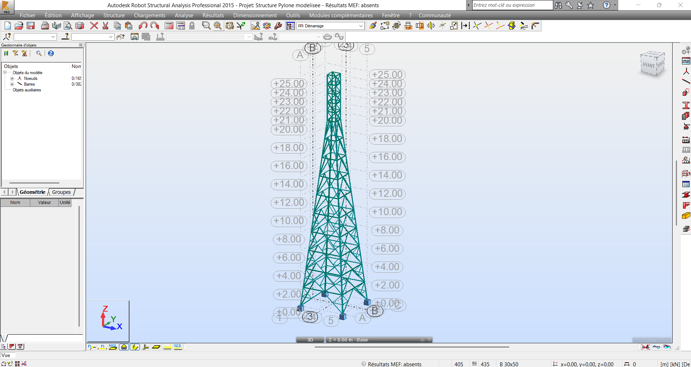
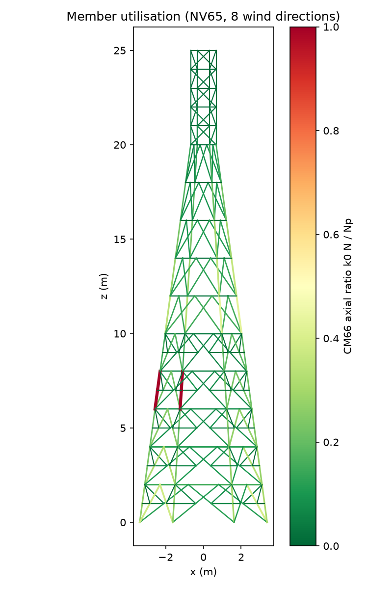

# Pylône télécom en treillis de 25 m : vent NV65 et vérification des barres CM66

🇬🇧 [English summary below](#english-summary)

J'ai modélisé un pylône télécom autostable de 25 m sous **Autodesk Robot Structural Analysis**, puis je l'ai vérifié de deux façons indépendantes : une note de calcul manuelle sous **Calcpad**, et un outil **Python** qui pilote Robot par son API et recalcule la tour avec son propre solveur 3D. Les deux vérifications concordent avec Robot. Elles ont aussi révélé des erreurs dans mon propre modèle, que le « profil correct » de Robot ne montrait pas. Ce dépôt présente le modèle, les vérifications, ce qu'elles ont trouvé et les corrections en cours.

<p align="center">
  
  
</p>

## La structure

| | |
|---|---|
| Type | Pylône autostable à section carrée, cornières à ailes égales boulonnées |
| Hauteur | 25 m : tronc pyramidal de 0 à 20 m (largeur 5 m à 1 m), fût droit de 1 × 1 m de 20 à 25 m |
| Barres | 382 barres : membrures L60×8, diagonales L50×6, barres secondaires (redondantes) L25×3, acier E24 |
| Charges | Poids propre et vent NV65 (région 1, site normal : hypothèses du modèle) |
| Règlements | NV65 (vent sur pylônes en treillis), CM66 et Additif 80 (vérification des barres) |

## Contenu du dépôt

| Dossier | Contenu |
|---|---|
| [`calcpad/`](calcpad) | Note de calcul manuelle : vent NV65 tronçon par tronçon, effort tranchant et moment de renversement, vérification des membrures, des diagonales et des barres secondaires. [PDF](calcpad/Pylone_telecom_25m_NV65_CM66.pdf) |
| [`src/`](src) | Outil Python : scripts de pilotage de Robot (API), solveur 3D avec analyse modale, vent NV65, vérifications CM66, rapport Excel |
| [`robot/`](robot) | Modèles Robot : l'original, et la version avec les sections de mon rapport de vérification |
| [`data/`](data) | Données du modèle extraites de Robot (JSON) : l'outil Python tourne sans Robot |
| [`results/`](results) | Rapports Excel, graphiques et résumés |
| [`tests/`](tests) | Contrôles automatiques de l'outil Python par rapport aux valeurs imprimées par Robot |

## Méthode

**1. Vent (NV65).** Pour chaque tronçon : taux de remplissage φ = Sp / S, coefficient de traînée Ct = 3,2 − 2φ pour les cornières (× (1 + 0,6φ) pour le vent sur la diagonale), effet de hauteur 2,5 (H + 18) / (H + 60), effet de dimension δ, et coefficient dynamique β = θ (1 + ξτ). La période propre nécessaire pour β vient d'une analyse modale : le premier mode de flexion est à **T ≈ 0,20 s**. La tour est donc raide et β reste proche de 1.

**2. Calcul.** L'outil Python reconstruit le modèle Robot (165 nœuds, 382 barres, caractéristiques et orientations réelles des sections) dans son propre solveur 3D, applique les combinaisons CM66 (4/3 G + 3/2 W, G + 3/2 W, G + 1,75 W en vent extrême) et vérifie **8 directions de vent** au lieu des 2 du modèle Robot.

**3. Vérification des barres (CM66, Additif 80).** Coefficient de flambement k0 = 1/χ avec la courbe c pour les cornières, vérification k0·N ≤ A·σe, et limites d'élancement (membrures 120, contreventement 200, barres secondaires 250).

**4. Calcul manuel (Calcpad).** Effort tranchant et moment de renversement par formules, efforts dans les membrures (2 membrures pour le vent sur une face, 1 membrure d'angle pour le vent diagonal), partage de l'effort tranchant entre les membrures inclinées et les diagonales, et règle usuelle de 2,5 % pour les barres secondaires.

## Validation

| Contrôle | Résultat |
|---|---|
| Compression maximale par famille, mêmes charges que Robot (poids propre et deux cas de vent) | à moins de **2 %** de Robot |
| Déplacement en tête | 7,42 mm (Python) contre 7,43 mm (Robot) |
| Vent NV65 par tronçon | à environ **5 %** de la note de vent de Robot (surfaces de contour identiques ; petite différence dans la mesure des largeurs exposées) |
| Coefficient de flambement k0 | identique aux notes de Robot (4,48 ; 1,76 ; 14,18) |
| Calcul manuel Calcpad et modèle 3D, membrure à 10 m | 19,9 kN contre 20,1 kN, taux de 0,42 dans les deux cas |

Pour lancer les contrôles : `python -m unittest discover tests`.

## Ce que les vérifications indépendantes ont trouvé

Ce sont des erreurs de mon propre modèle Robot. Robot déclarait toutes les familles correctes, car chaque vérification ne couvre que ce que le modèle contient.

1. **Des tronçons de membrure avec la mauvaise section.** Entre 6 et 8 m, deux tronçons de membrure portent la section des barres secondaires, et une membrure entre 20 et 25 m porte celle des diagonales. Sous un vent diagonal venant d'une direction absente du modèle, la membrure entre 6 et 7 m atteint un taux d'environ **4** (barres rouges sur la carte).
2. **Seulement 2 directions de vent sur 8** étaient étudiées dans le modèle.
3. **Des diagonales non reliées aux barres secondaires.** 18 diagonales traversent le nœud à mi-longueur du contreventement secondaire sans y être connectées. Elles flambent donc sur toute leur longueur : élancement de **331** au lieu d'environ **165** une fois reliées.
4. **Des élancements au-dessus des limites usuelles**, même là où la résistance passe : membrures à 174 (limite 120) entre 10 et 20 m, barres secondaires à 303 (limite 250).
5. **Des fichiers incohérents entre eux.** Le modèle enregistré, mon rapport de vérification et mes notes de calcul par barre correspondaient à des jeux de sections différents, et le vent n'avait pas été régénéré après le changement des sections.

Une fois les sections des membrures corrigées, la résistance est confortable (taux d'environ 0,4 pour les membrures et les diagonales). Le vrai sujet est l'élancement, pas la résistance ([`results/summary_legs_fixed.txt`](results/summary_legs_fixed.txt)).

## Corrections en cours

- [ ] Donner la section L60×8 à tous les tronçons de membrure
- [ ] Relier les 18 diagonales aux nœuds à mi-longueur du contreventement secondaire
- [ ] Ajouter une barre secondaire à mi-panneau sur les membrures entre 10 et 20 m
- [ ] Passer les barres secondaires en L35×4
- [ ] Régénérer le vent dans toutes les directions, avec la période issue de l'analyse modale
- [ ] Relancer les vérifications de Robot et mettre à jour ce dépôt

## Utilisation

```bash
pip install -r requirements.txt
python src/run_design.py              # modèle tel quel
python src/run_design.py --fix-legs   # avec les sections des membrures corrigées
python -m unittest discover tests
```

Les scripts `src/robot_*.py` nécessitent Robot Structural Analysis 2015 sous Windows (API de Robot via `pywin32`). Tout le reste fonctionne à partir des fichiers JSON du dossier `data/`.

## Limites

Les assemblages boulonnés, les platines, les tiges d'ancrage et les fondations ne sont pas traités. La région de vent, le site et le coefficient ξ (NV65 fig. R-III-3) sont des hypothèses à confirmer pour un site réel. C'est un projet personnel d'auto-formation, pas une étude d'exécution.

## Références

- Règles NV65 (neige et vent), chapitre III, pylônes en treillis
- Règles CM66 et Additif 80
- Documents qui m'ont servi de référence : A. Benchekroun, *Dimensionnement d'un pylône* (2015) ; S. Hadi et N. Mezhoud, *Analyse de la stabilité des pylônes à treillis*, mémoire de master, Université Badji Mokhtar Annaba (2016)

---

## English summary

I modelled a 25 m self-supporting telecom lattice tower in Robot Structural Analysis, then checked it independently in two ways: a hand calculation in Calcpad, and a Python tool that drives Robot through its API and recomputes the tower with its own 3D solver (NV65 wind, CM66 / Additif 80 buckling checks). Both checks agree with Robot within 2 to 5 %. They also found errors in my own model: leg segments with the wrong section between 6 and 8 m, only 2 of 8 wind directions checked, and 18 diagonals not connected to the secondary bracing, which gives a slenderness of 331 instead of about 165. With the legs corrected, strength is comfortable; the real issue is slenderness. The fixes are in progress (see the checklist above). The calculation note in `calcpad/` is in French.

**Omar Elgour**, Ingénieur d'État en Génie Civil (EMSI Marrakech) · [LinkedIn](https://www.linkedin.com/in/omar-elgour)
